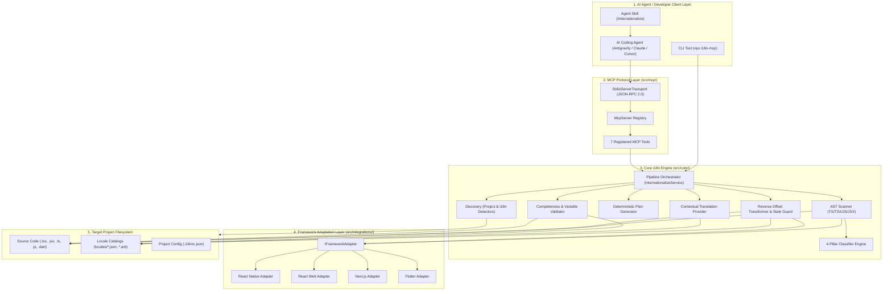
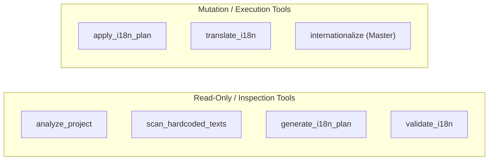
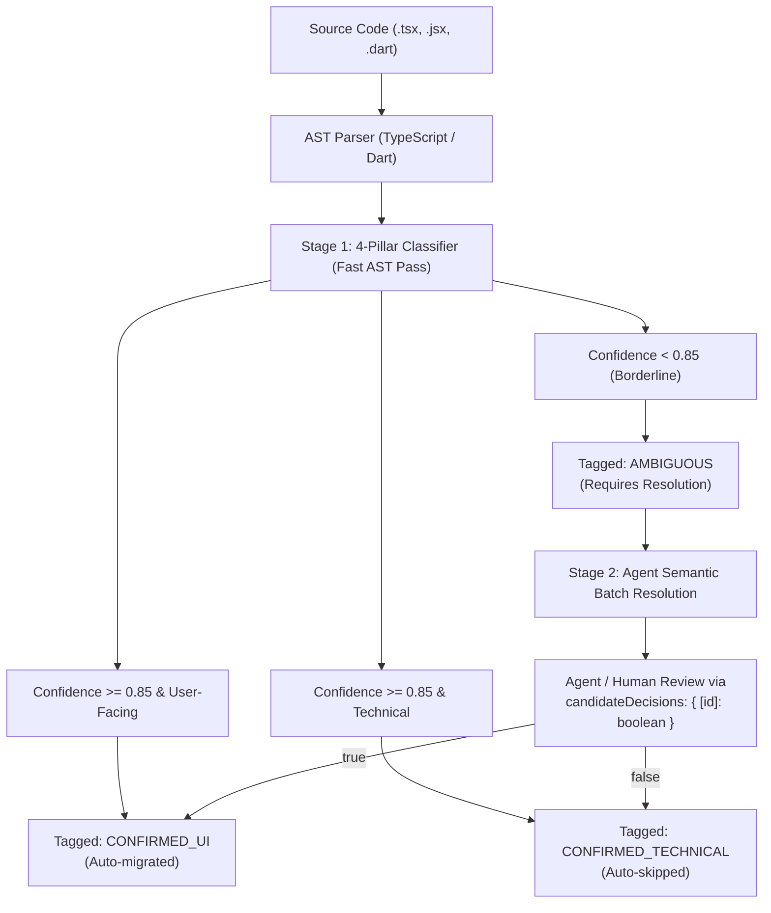
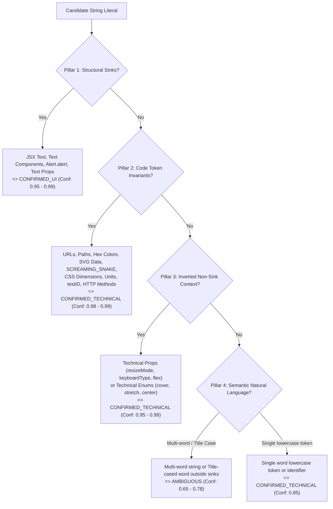
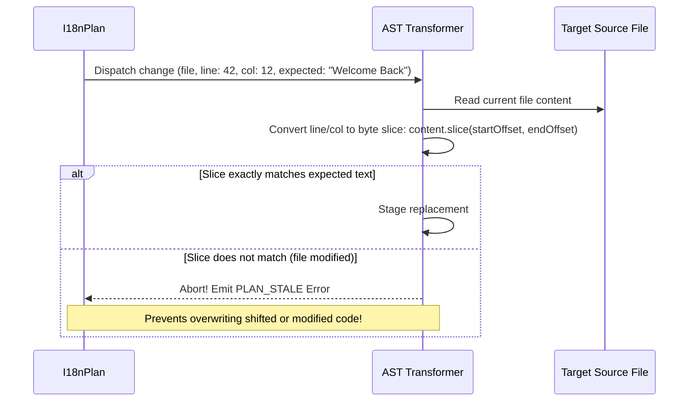
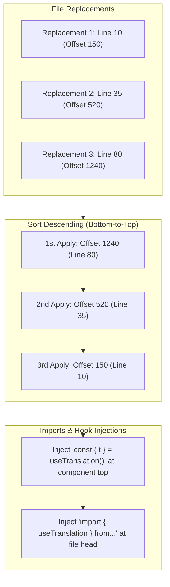
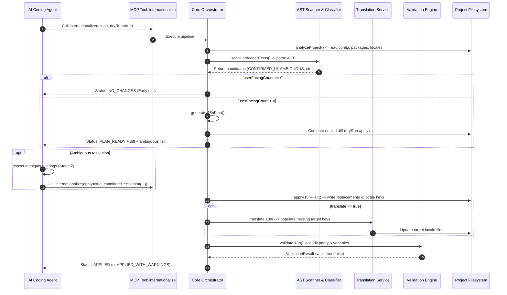

# Architectural Blueprint & Technical Specification: `i18n-mcp`

> **Multi-Framework Internationalization Model Context Protocol (MCP) Server**  
> *Target Frameworks: React Native, React (Web), Next.js, Flutter*  
> *Target AI Clients: Google Antigravity, Claude Code, Cursor, Windsurf, Gemini CLI, Custom Agents*

---

## Table of Contents

1. [Executive Overview & Mission](#1-executive-overview--mission)
2. [High-Level Architecture](#2-high-level-architecture)
3. [Component Breakdown by Layer](#3-component-breakdown-by-layer)
   - [Layer 1: Protocol & Transport Layer](#layer-1-protocol--transport-layer)
   - [Layer 2: Pipeline Orchestration Layer](#layer-2-pipeline-orchestration-layer)
   - [Layer 3: Framework Adapter System](#layer-3-framework-adapter-system)
   - [Layer 4: Project & i18n Discovery](#layer-4-project--i18n-discovery)
   - [Layer 5: AST Scanner & 4-Pillar Classification](#layer-5-ast-scanner--4-pillar-classification)
   - [Layer 6: Key & Namespace Generation](#layer-6-key--namespace-generation)
   - [Layer 7: Safe Transformation & AST Rewriter](#layer-7-safe-transformation--ast-rewriter)
   - [Layer 8: Contextual Translation Service](#layer-8-contextual-translation-service)
   - [Layer 9: Verification & Validation Engine](#layer-9-verification--validation-engine)
4. [The 7 MCP Tools Reference](#4-the-7-mcp-tools-reference)
5. [Key Algorithms & Core Innovations](#5-key-algorithms--core-innovations)
   - [Two-Stage Hybrid String Detection](#two-stage-hybrid-string-detection)
   - [The 4-Pillar Classifier Engine](#the-4-pillar-classifier-engine)
   - [Stale-Plan Protection & Source Verification](#stale-plan-protection--source-verification)
   - [Reverse-Offset AST Transformation](#reverse-offset-ast-transformation)
6. [End-to-End Execution Lifecycles](#6-end-to-end-execution-lifecycles)
   - [The Complete Pipeline (`internationalize`)](#the-complete-pipeline-internationalize)
   - [Agent Interactive Workflow (`/internationalize`)](#agent-interactive-workflow-internationalize)
7. [Directory Structure & Module Map](#7-directory-structure--module-map)
8. [Configuration & Extensibility](#8-configuration--extensibility)

---

## 1. Executive Overview & Mission

Internationalizing existing frontend codebases has traditionally been a grueling, error-prone manual endeavor. Developers must manually scour thousands of lines of code, differentiate user-facing text from technical constants and style keys, create unique translation keys, extract strings into nested locale JSON/ARB dictionaries, import hooks or accessors, and substitute call expressions without breaking syntax or layouts.

`i18n-mcp` is a **Model Context Protocol (MCP)** server built to automate this entire lifecycle. It is specifically designed to pair with **AI coding agents** and human developers.

### Core Objectives:
- **Zero-Hallucination Parsing**: Uses native TypeScript Compiler AST (`ts.createSourceFile`) rather than fragile regular expressions to understand code structure.
- **Two-Stage Hybrid Classification**: Deterministic AST rules categorize >90% of strings instantly with zero latency, tagging ambiguous boundary cases for AI-agent semantic review.
- **Safety by Default**: Dry-run preview mode (`dryRun: true, apply: false`) is the default. Every modification yields unified diffs for human or agent verification before disk writes.
- **Atomic, Drift-Free Code Rewriting**: Sorts replacements descending by character position so earlier offsets do not drift during string substitution.
- **Stale-Plan Guard**: Validates source code hashes/slices at runtime. If the underlying code changes between planning and applying, execution halts safely.

---

## 2. High-Level Architecture

The system is organized into a modular layered architecture where protocol handling, framework-specific logic, language AST scanning, and safe file mutations are strictly separated:



---

## 3. Component Breakdown by Layer

### Layer 1: Protocol & Transport Layer
- **`src/mcp/server.ts`**: Initializes the `@modelcontextprotocol/sdk` `McpServer` instance, connects it to standard I/O via `StdioServerTransport`, registers SIGINT/SIGTERM lifecycle shutdown listeners, and handles direct process startup.
- **`src/mcp/tools/`**: Exposes 7 strongly-typed tools using `zod` schemas. Ensures all tool arguments and return structures adhere to strict JSON-RPC contracts.
- **`src/cli/index.ts`**: Provides a standalone terminal interface using `commander` for developers executing scans or migrations outside an MCP agent environment.

### Layer 2: Pipeline Orchestration Layer
- **`src/core/orchestration/internationalize-service.ts`**: The master state machine. It controls the lifecycle:
  1. `analyzeProject`: Discovers framework, libraries, and existing locales.
  2. `scanHardcodedTexts`: Scans target scope for strings.
  3. *Early Exit Check*: If 0 user-facing strings are found, immediately returns `NO_CHANGES` to save cycles.
  4. `generateI18nPlan`: Synthesizes semantic keys, namespaces, and source transforms. Incorporates `candidateDecisions`.
  5. *Dry-Run Gate*: If `apply === false` or `dryRun === true`, stops here, computes unified diffs, and returns `PLAN_READY`.
  6. `applyI18nPlan`: If `apply === true`, performs atomic file updates and backup creation.
  7. `translateI18n`: If `translate === true`, populates missing target locale keys.
  8. `validateI18n`: Audits all generated locale files and source references.
  9. *Final Status Calculation*: Emits `APPLIED`, `APPLIED_WITH_WARNINGS`, `REVIEW_REQUIRED`, `PENDING_TRANSLATIONS`, or `FAILED`.

### Layer 3: Framework Adapter System
Located in `src/integrations/adapters/`, this layer decouples generic AST string analysis from framework-specific conventions via the `FrameworkAdapter` interface:

| Method / Property | React Native (`react-native`) | React Web (`react-web`) | Next.js (`nextjs`) | Flutter (`flutter`) |
| :--- | :--- | :--- | :--- | :--- |
| **File Extensions** | `.tsx`, `.jsx`, `.ts`, `.js` | `.tsx`, `.jsx`, `.ts`, `.js` | `.tsx`, `.jsx`, `.ts`, `.js` | `.dart` |
| **Text Sinks** | `<Text>`, `<Title>`, `<Typography>`, `<Heading>`, etc. | `<p>`, `<span>`, `<h1>`-`<h6>`, `<button>`, `<div>` | React text sinks + `<Link>`, metadata headers | `Text()`, `SelectableText()`, `TextSpan()`, `RichText()` |
| **Text Props** | `title`, `placeholder`, `accessibilityLabel`, `label`, `error` | `placeholder`, `aria-label`, `alt`, `title` | React text props + `metaTitle`, `description` | `title`, `label`, `hintText`, `errorText`, `tooltip` |
| **Feedback Sinks** | `Alert.alert`, `toast`, `snackbar`, `showDialog` | `window.alert`, `confirm`, `toast` | `toast`, `alert`, `notify` | `SnackBar`, `showDialog`, `AlertDialog` |
| **Default Hook / Syntax** | `useTranslation()` (`react-i18next`) | `useTranslation()` (`react-i18next`) | `useTranslations()` (`next-intl`) | `AppLocalizations.of(context)!` |

### Layer 4: Project & i18n Discovery
- **`src/core/discovery/project-detector.ts`**: Inspects `package.json`, `pubspec.yaml`, lockfiles, and folder structures to detect framework (React Native, React, Next.js, Flutter), language (TypeScript, JavaScript, Dart), and package manager (npm, yarn, pnpm, bun, flutter pub).
- **`src/core/discovery/i18n-detector.ts`**: Detects existing i18n setups (`react-i18next`, `i18next`, `next-intl`, `flutter_localizations`), finds locale root directories (`src/locales`, `assets/locales`, `i18n`, `locales`, `lib/l10n`), identifies source/target locales, and catalogs all active namespaces.

### Layer 5: AST Scanner & 4-Pillar Classification
- **`src/core/scanner/ast-scanner.ts`**: Uses TypeScript Compiler API to construct an Abstract Syntax Tree (`ts.createSourceFile`). Traverses AST nodes recursively, extracting:
  - JSX text children (`ts.isJsxText`).
  - JSX attribute string literals (`ts.isJsxAttribute`).
  - Object property assignments (`ts.isPropertyAssignment`).
  - Call expression arguments (`ts.isCallExpression`).
  - Template literals with interpolations (`ts.isTemplateExpression`).
- **`src/core/classifier/classifier.ts`**: Houses the **4-Pillar Classification Engine** (detailed in Section 5).

### Layer 6: Key & Namespace Generation
- **`src/core/keys/key-generator.ts`**:
  - Direct Action Lookup: Standard phrases map to universal keys (`"Save"` $\rightarrow$ `SAVE`, `"Cancel"` $\rightarrow$ `CANCEL`, `"Forgot password?"` $\rightarrow$ `FORGOT_PASSWORD`, `"Sign In"` $\rightarrow$ `SIGN_IN`).
  - Semantic Morphology: Strips punctuation, filters special characters, selects the first 5 descriptive words, and forms uppercase snake_case (`"Enter your registered email address"` $\rightarrow$ `ENTER_YOUR_REGISTERED_EMAIL_ADDRESS`).
  - Interpolation Sanitizer: Strips `{{var}}` or `${var}` expressions prior to key slugging.
- **`src/core/namespace/namespace-resolver.ts`**:
  - Global Common: Common actions automatically route to `common`.
  - Feature-Based Routing: Detects folder patterns (`src/features/<feature>/...` $\rightarrow$ `<feature>`).
  - Config Overrides: Uses user-defined glob paths in `.i18nrc.json`.
- **`src/core/planning/key-collision-resolver.ts`**:
  - If a key collision occurs with identical text, reuses the existing translation.
  - If a key collision occurs with differing text, appends a semantic suffix or numeric increment (`LOGIN_BUTTON`, `LOGIN_TITLE`, `LOGIN_2`).

### Layer 7: Safe Transformation & AST Rewriter
- **`src/core/replacement/ast-transformer.ts`**:
  - Calculates line and column character offsets into byte positions.
  - Compares the actual file text against `expectedSource` at the target coordinates.
  - Injects required imports (`import { useTranslation } from "react-i18next"`) at the top of the file.
  - Injects hook declarations (`const { t } = useTranslation("auth");`) into the enclosing functional component body.
  - Applies replacements from bottom to top (descending character offsets) to maintain offset stability.
- **`src/core/replacement/diff-generator.ts`**: Computes unified diff previews (`--- a/file`, `+++ b/file`, `@@ ... @@`) identical to Git format for developer review.
- **`src/core/replacement/plan-applicator.ts`**: Executes atomic disk writes, updates locale JSON/ARB dictionaries, and optionally creates `.bak` backups.

### Layer 8: Contextual Translation Service
- **`src/core/translation/translation-service.ts`**:
  - Scans target locale files for missing keys present in the source locale (`en`).
  - Uses `DictionaryTranslationProvider` containing curated UI glossaries across French (`fr`), Spanish (`es`), German (`de`), Arabic (`ar`), and more.
  - Preserves interpolation tags (`{{name}}`, `{name}`) without translating variable identifiers.
  - Flags untranslated or fallback keys with `PENDING` or `REVIEW` status without breaking build pipelines.

### Layer 9: Verification & Validation Engine
- **`src/core/validation/i18n-validator.ts`**:
  - **Missing Translations**: Verifies all keys in `sourceLocale` exist across all `targetLocales`.
  - **Variable Parity**: Compares interpolation variables (e.g. `{{count}}`) between source and target strings. If the French translation has `{{compte}}` instead of `{{count}}`, reports an error.
  - **Syntax & Schema**: Checks for malformed JSON, invalid ARB headers, and trailing syntax defects.
  - **Orphan Detection**: Cross-references keys across code and catalogs to find unused translations.

---

## 4. The 7 MCP Tools Reference



### 1. `analyze_project`
*Zero-mutation project inspection.*
- **Arguments**: `projectPath` (string, optional).
- **Outputs**: Framework, language, package manager, detected i18n library, locale directory, source and target locales, namespaces, code access patterns (`useTranslation`, `t`, `Trans`), and configuration warnings.

### 2. `scan_hardcoded_texts`
*AST string discovery and classification.*
- **Arguments**:
  - `projectPath` (string, optional)
  - `scope` (string | string[], optional): Files, directories, or glob patterns.
  - `include` / `exclude` (string[], optional): Custom glob patterns.
  - `onlyUserFacing` (boolean, optional, default: `true`): Filters out technical strings.
  - `minConfidence` (number, optional, default: `0.0`): Confidence floor (0.0 to 1.0).
  - `ambiguousOnly` (boolean, optional, default: `false`): Isolates borderline cases needing agent review.
- **Outputs**: List of candidates with `id` (`file:line:col`), `text`, `semanticRole` (`CONFIRMED_UI`, `CONFIRMED_TECHNICAL`, `AMBIGUOUS`), `confidence`, `suggestedKey`, `suggestedNamespace`, and extracted interpolation variables.

### 3. `generate_i18n_plan`
*Deterministic migration blueprint creation without disk writes.*
- **Arguments**: `projectPath`, `scope`, `include`, `exclude`, `sourceLocale`, `targetLocales`, `confidenceThreshold`, `includeAmbiguous`, `candidateDecisions`.
- **Outputs**: An immutable `I18nPlan` containing:
  - Source changes list (`file`, `action: REPLACE`, `source`, `replacement`, `location`, `requiredCodeChanges`).
  - Translation updates map per locale and namespace.
  - Required i18n library setup steps (if uninitialized).
  - Summary metrics and source hashes for stale prevention.

### 4. `apply_i18n_plan`
*Atomic execution of an approved migration plan.*
- **Arguments**:
  - `plan` or `planPath` (I18nPlan object or JSON file path).
  - `dryRun` (boolean, optional, default: `false`): Generates diff without writing.
  - `createBackup` (boolean, optional, default: `false`): Creates `.bak` files.
  - `failOnWarnings` (boolean, optional, default: `false`): Aborts if warnings exist.
- **Outputs**: Applied metrics (`filesChanged`, `sourceChangesApplied`, `translationEntriesCreated`), warnings, errors, and Git-compatible unified diff.

### 5. `translate_i18n`
*Missing translation population.*
- **Arguments**: `projectPath`, `sourceLocale`, `targetLocales`, `namespaces`, `dryRun`.
- **Outputs**: Translation results (`translated`, `unchanged`, `pending`, `review`), modified locale files, and glossary match statistics.

### 6. `validate_i18n`
*Completeness and consistency verification.*
- **Arguments**: `projectPath`, `locales`, `namespaces`, `checkSourceCode`, `scope`.
- **Outputs**: Boolean `valid`, error/warning counts, and granular issue list (`MISSING_TRANSLATION`, `VARIABLE_MISMATCH`, `MALFORMED_JSON`, `EMPTY_TRANSLATION`).

### 7. `internationalize`
*Master pipeline orchestrator.*
- Combines analyze, scan, ambiguity resolution, plan, apply, translate, and validate into a single atomic workflow.
- By default operates with safe flags: `dryRun: true`, `apply: false`.

---

## 5. Key Algorithms & Core Innovations

### Two-Stage Hybrid String Detection

Conventional internationalization tools either rely on brittle regular expressions (missing context and generating high false positives) or attempt to pass massive codebases into LLMs (expensive, slow, non-deterministic). `i18n-mcp` implements a two-stage hybrid approach:



### The 4-Pillar Classifier Engine

The classifier evaluates every string literal against four hierarchical pillars:



#### Detailed Pillar Breakdown:
1. **Pillar 1: Structural Text Sinks**:
   - `ts.isJsxText`: Unconditionally `CONFIRMED_UI`.
   - Component matching: Known text containers (`<Text>`, `<Paragraph>`, `<Heading>`).
   - Prop matching: Designated text attributes (`placeholder`, `accessibilityLabel`, `helperText`, `errorMessage`).
   - Feedback calls: `Alert.alert(...)`, `Toast.show(...)`, `SnackBar(...)`.
2. **Pillar 2: Code Token Filtering**:
   - Syntactic Invariants: URLs (`https://`), file paths (`./assets/`, `/icons`), extensions (`.png`, `.svg`).
   - Graphic & CSS tokens: Hex codes (`#FFFFFF`), `rgb()`, `hsl()`, SVG path data (`M 10 10 L 20 20...`), CSS dimensions (`16px`, `2rem`, `100%`).
   - Morphological Constants: `SCREAMING_SNAKE_CASE` (e.g. `AUTH_TOKEN`, `API_KEY`), hierarchical IDs (`@scope/PACKAGE`).
   - Test and Automation attributes: `testID`, `data-testid`, `accessibilityIdentifier`.
3. **Pillar 3: Inverted Non-Sink Default**:
   - In modern UI components, 95% of props are technical layout/configuration parameters (`flexDirection`, `keyboardType`, `returnKeyType`, `autoCapitalize`, `resizeMode`).
   - Unless a prop is explicitly recognized as a text sink, string values matching technical enums default to `CONFIRMED_TECHNICAL`.
4. **Pillar 4: Semantic Role Tagging**:
   - Strings with confidence $\ge 0.85$ are resolved deterministically (`CONFIRMED_UI` or `CONFIRMED_TECHNICAL`).
   - Borderline strings (confidence $< 0.85$, such as title-cased single words or multi-word literals passed to custom props) are tagged `AMBIGUOUS`.

---

### Stale-Plan Protection & Source Verification

When an AI agent or developer reviews a migration plan, other file edits or Git rebases might occur before the plan is applied. To prevent corrupting files, `applyI18nPlan` implements source verification:



---

### Reverse-Offset AST Transformation

Applying multiple text replacements from top to bottom causes character offsets of later strings to shift, leading to corruption. `i18n-mcp` computes byte ranges up front and sorts all modifications in **descending offset order (bottom to top)**:



*By replacing from the bottom up, earlier string positions (offsets 150 and 520) remain stable regardless of how much text is inserted at offset 1240.*

---

## 6. End-to-End Execution Lifecycles

### The Complete Pipeline (`internationalize`)



### Agent Interactive Workflow (`/internationalize`)

When a developer invokes `/internationalize` in an AI agent chat:
1. **Agent Invocation**: The agent sets `dryRun: true, apply: false` to inspect the project.
2. **Review Output**: The MCP server returns a summary of detected UI strings, technical strings filtered, and proposed translation keys.
3. **Ambiguity Resolution**: If ambiguous candidates exist, the agent evaluates their semantic role and records decisions (`true` or `false`).
4. **Developer Approval**: The agent shows the unified diff and asks the developer: *"Would you like to apply these changes?"*
5. **Atomic Execution**: On approval, the agent calls `internationalize` with `apply: true` and the bundled `candidateDecisions`.

---

## 7. Directory Structure & Module Map

```text
i18n-mcp/
├── .agents/skills/internationalize/     # Antigravity agent skill definition
│   └── SKILL.md                         # Slash command & agent instructions
├── .claude/skills/internationalize/     # Claude Code skill definition
│   └── SKILL.md
├── src/
│   ├── cli/                             # Standalone command-line interface
│   │   ├── commands/scan.ts             # 'npx i18n-mcp scan' command
│   │   └── index.ts                     # Commander CLI entrypoint
│   ├── config/                          # Configuration handling
│   │   └── config-loader.ts             # Loads .i18nrc.json / i18n.config.json
│   ├── core/                            # Framework-agnostic i18n engine
│   │   ├── classifier/                  # 4-Pillar classification engine
│   │   │   ├── classifier.ts            # Core classification logic & regexes
│   │   │   └── index.ts
│   │   ├── discovery/                   # Project & environment detection
│   │   │   ├── i18n-detector.ts         # Detects libraries, locales, namespaces
│   │   │   ├── project-analyzer.ts      # Aggregates project architecture
│   │   │   └── project-detector.ts      # Framework, language, package manager
│   │   ├── keys/                        # Translation key generation
│   │   │   └── key-generator.ts         # Semantic UPPER_SNAKE_CASE & action map
│   │   ├── namespace/                   # Namespace routing
│   │   │   └── namespace-resolver.ts    # Feature folder & common mapping
│   │   ├── orchestration/               # Master execution pipeline
│   │   │   └── internationalize-service.ts # End-to-end coordinator
│   │   ├── planning/                    # Plan generation & collision resolution
│   │   │   ├── existing-key-resolver.ts # Deduplication against existing catalogs
│   │   │   ├── key-collision-resolver.ts# Suffixing for duplicate keys
│   │   │   ├── locale-change-planner.ts # Prepares locale JSON/ARB updates
│   │   │   ├── plan-generator.ts        # Assembles the complete I18nPlan
│   │   │   └── source-change-planner.ts # Plans replacements, imports, hooks
│   │   ├── replacement/                 # Safe source rewriting & diffs
│   │   │   ├── ast-transformer.ts       # Bottom-to-top replacement & stale check
│   │   │   ├── diff-generator.ts        # Git-style unified diff generator
│   │   │   ├── locale-updater.ts        # Writes nested locale dictionaries
│   │   │   ├── plan-applicator.ts       # Atomic applicator with backup support
│   │   │   └── source-replacer.ts
│   │   ├── scanner/                     # AST file parsing
│   │   │   ├── ast-scanner.ts           # TypeScript Compiler AST visitor
│   │   │   └── scanner.ts               # Multi-file scope scanner
│   │   ├── scope/                       # File discovery & globbing
│   │   │   └── scope-resolver.ts        # Resolves target files using fast-glob
│   │   ├── setup/                       # Library bootstrap planner
│   │   │   └── setup-planner.ts         # Plans setup for uninitialized projects
│   │   ├── translation/                 # Translation engine
│   │   │   ├── dictionaries/            # Multi-language curated glossaries
│   │   │   ├── translation-provider.ts  # ITranslationProvider interface
│   │   │   └── translation-service.ts   # Missing key translation coordinator
│   │   └── validation/                  # Quality assurance & verification
│   │       └── i18n-validator.ts        # Missing keys, syntax, variable parity
│   ├── integrations/                    # Framework adapters
│   │   └── adapters/
│   │       ├── flutter.adapter.ts       # Flutter & Dart localizations
│   │       ├── framework-adapter.interface.ts # Adapter contract
│   │       ├── nextjs.adapter.ts        # Next.js App/Pages router
│   │       ├── react-native.adapter.ts  # React Native & react-i18next
│   │       └── react-web.adapter.ts     # React Web & DOM text sinks
│   ├── mcp/                             # Model Context Protocol layer
│   │   ├── server.ts                    # McpServer & stdio transport
│   │   └── tools/                       # The 7 MCP tool handlers
│   │       ├── analyze-project.ts
│   │       ├── apply-i18n-plan.ts
│   │       ├── generate-i18n-plan.ts
│   │       ├── index.ts
│   │       ├── internationalize.ts
│   │       ├── scan-hardcoded-texts.ts
│   │       ├── translate-i18n.ts
│   │       └── validate-i18n.ts
│   ├── models/                          # TypeScript types & contracts
│   │   ├── config.ts                    # User configuration schemas
│   │   ├── errors.ts                    # Error code definitions
│   │   ├── internationalize.ts          # Pipeline input/output schemas
│   │   ├── plan.ts                      # I18nPlan & CodeChange models
│   │   ├── project.ts                   # Project metadata models
│   │   ├── replacement.ts               # Apply input/output models
│   │   ├── scanner.ts                   # DetectedString & Classification models
│   │   ├── setup.ts                     # Bootstrap setup models
│   │   ├── translation.ts               # Translation models
│   │   └── validation.ts                # ValidationIssue & Result models
│   ├── utils/                           # Core utilities
│   │   ├── file-system.ts               # Safe I/O, POSIX path normalization
│   │   ├── logger.ts                    # Stderr logging (protects stdio JSON-RPC)
│   │   └── nested-json.ts               # Dot-notation object flattening/unflattening
│   └── index.ts                         # Public API export
├── test/                                # Test suite (34 test files, 202 tests)
├── package.json                         # Node dependencies & scripts
└── tsconfig.json                        # TypeScript compiler configuration
```

---

## 8. Configuration & Extensibility

Projects can customize `i18n-mcp` behavior by placing a `.i18nrc.json` or `i18n.config.json` file in their project root:

```json
{
  "$schema": "https://json.schemastore.org/i18n-mcp.json",
  "framework": "react-native",
  "sourceLocale": "en",
  "targetLocales": ["fr", "es", "de", "ar"],
  "localeDirectory": "src/locales",
  "namespaces": {
    "src/features/auth/**": "auth",
    "src/features/checkout/**": "checkout",
    "src/components/**": "common"
  },
  "include": [
    "src/**/*.{ts,tsx}"
  ],
  "exclude": [
    "**/*.test.{ts,tsx}",
    "**/*.spec.{ts,tsx}",
    "**/__tests__/**"
  ],
  "keyNaming": "UPPER_SNAKE_CASE",
  "confidenceThreshold": 0.7
}
```

### Adding New Framework Adapters
To support additional ecosystems (e.g. Vue, Svelte, Angular, iOS Swift):
1. Implement the `FrameworkAdapter` interface in `src/integrations/adapters/`.
2. Define component text sinks, text attributes, and feedback callees.
3. Define the translation accessor syntax (`getDefaultTranslationPattern`).
4. Register the adapter in `src/integrations/adapters/index.ts`.
